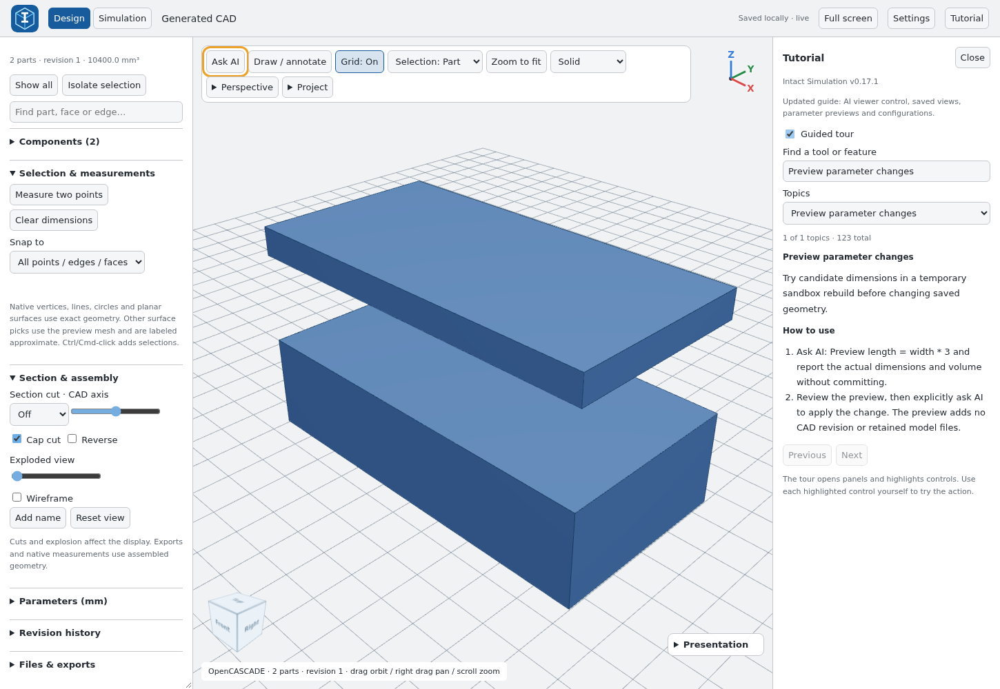
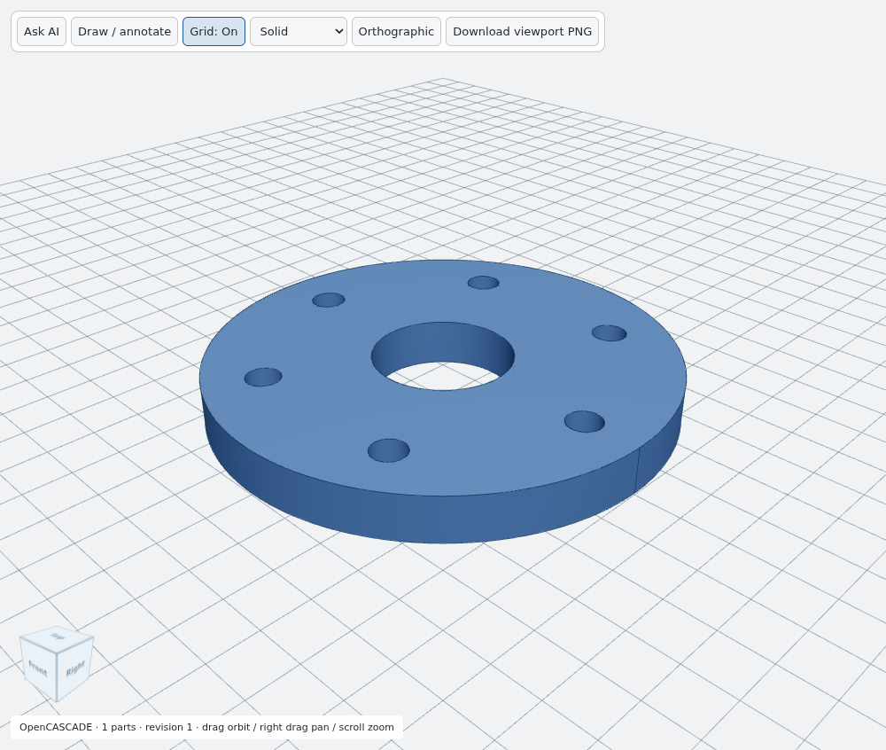
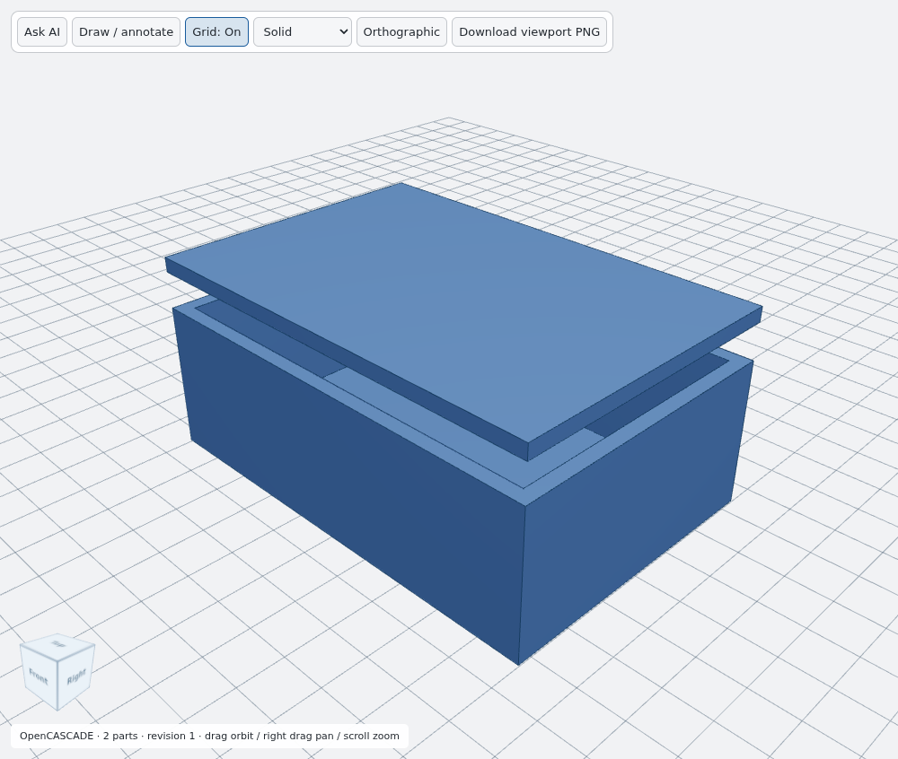
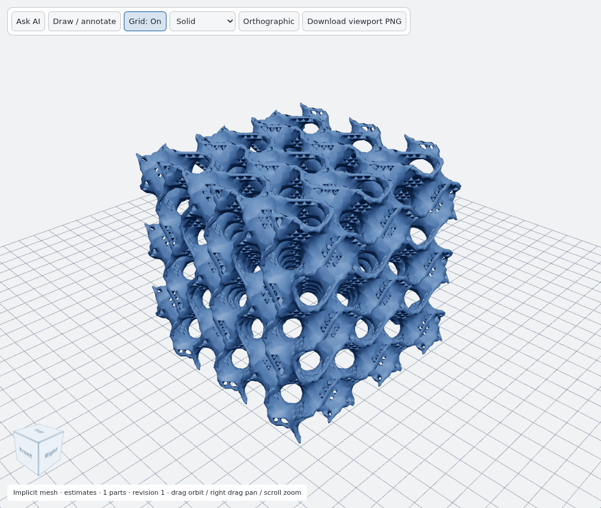

# Intact Simulation

**Design, inspect and simulate CAD through an AI conversation.**

[Website](https://www.intactsimulation.com/) · [Installation](docs/install.md) · [Examples](models/README.md) · [Architecture](docs/architecture.md) · [Contributing](CONTRIBUTING.md) · [ChatGPT launch procedure](docs/CHATGPT_LAUNCH.md)

Intact gives an AI assistant local tools to create parametric parts and assemblies, inspect native geometry, edit designs and run supported engineering studies. The assistant reasons in your conversation; open-source CAD and numerical engines execute on your computer. No LiteLLM or separate model-service API key is required for the ChatGPT workflow.

## Quickstart

The supported local execution environment is **Linux x86-64 or Windows with WSL2/Ubuntu**, Python 3.12–3.13, `uv`, and working bubblewrap user namespaces. Native Windows and macOS execution are not currently supported. Install [uv](https://docs.astral.sh/uv/getting-started/installation/) first.

```bash
git clone https://github.com/mnswba/Intact-Simulation.git
cd Intact-Simulation
sudo apt-get update
sudo apt-get install -y build-essential bubblewrap libgl1 libglu1-mesa libxft2
python3 scripts/install-chatgpt-plugin.py
```

For the Windows ChatGPT desktop app, run the installer **inside WSL** with your Windows profile path:

```bash
python3 scripts/install-chatgpt-plugin.py --windows-home /mnt/c/Users/YOUR_WINDOWS_USER
```

The installer downloads a checksum-pinned FreeCAD runtime and prepares the Python/CAD environment. Restart ChatGPT, enable **Intact Simulation** in your personal plugin marketplace, and ask:

> Create an 80 mm diameter pipe flange, 8 mm thick, with a 24 mm bore and six 6 mm holes on a 60 mm bolt circle. Verify the hole positions and export STEP.

This installs a local development plugin. Publishing this repository does not list it in the ChatGPT public directory. See [installation and client support](docs/install.md) for MCP/Claude Code setup, runtime checks and troubleshooting.

## Features

| Area | Available workflows |
| --- | --- |
| CAD generation | build123d/OpenCASCADE Python, native solids, named parts, assemblies and STEP imports |
| Design intent | Structured dimensions and requirements, FreeCAD sketch constraints and actual solver diagnostics |
| Editable history | Explicit feature graphs with supported sketch/extrude/revolve/hole/fillet/chamfer/boolean/pattern/transform operations |
| Geometry inspection | Parts, faces, edges, vertices, native measurements, snapping and named references with ambiguity detection |
| Viewer | Viewport-only fullscreen, right-click geometry actions, zoom/fit, standard projections, model-attached text, exploded component labels, collapsible components and five recent models |
| Ask AI | Select geometry, attach references/sketches, describe an edit or question, rebuild and refresh; Automatic Ask AI submission and clarification replies |
| Verification | Native validity, saved dimension/hole/placement/clearance checks, requested tolerance and mesh convergence reports |
| Lattices | Six sampled TPMS families, distance offsets, envelopes, mesh booleans and hybrid geometry |
| Engineering | AI tools for bounded joints, reconstruction, manufacturing screening, reference drawings and background jobs; Design stays focused; simulation jobs appear in Simulation |
| Simulation | Separate Virtual and Mechanical workspaces: kinematic driving, walking and machine previews; 3D thermal, static stress and creeping-flow Stokes, AI-prepared face conditions, automatic mesh sizing, colored fields, playback and CSV/VTU downloads |
| Exports | STEP, ASCII/binary STL, GLB, 3MF, Python, project JSON, binary USD and text USDA; Project adds annotated PNG, PPTX, BOM CSV, 2D DXF/DWG and conditional FCStd/source STEP |

Version **0.16.1** exposes **57 MCP tools**. [Latest changes](docs/RELEASE_0_16_1.md) · [Solver verification](docs/RELEASE_0_16.md). See [tool contracts](plugin/skills/intact-cad/references/priority23.md) and [structured modeling](plugin/skills/intact-cad/references/structured-modeling.md) for inputs and limits.

The **Tutorial** button next to Settings includes searchable help topics and an optional guided tour. Each topic explains a control, its purpose and usage steps. Use the mouse wheel for zoom and **Zoom to fit** beside Grid.



See [v0.15 workflow and verification](docs/RELEASE_0_15.md) and [Simulation instructions](docs/simulation.md) and [verification results](docs/SIMULATION_0_14_AUDIT.md). The complete v0.13 Design workspace remains available under **Design**. [v0.15 changes](docs/RELEASE_0_15.md) add native click gestures, fullscreen presentation, AI-driven analysis, kinematic previews and optional PicoGK TPMS.

## Example workflows

| Flange | Enclosure | Gyroid |
| --- | --- | --- |
|  |  |  |

These are actual viewer renders of the bundled examples.

### Parts and assemblies

> Design a two-part electronics enclosure with a 60 × 40 × 20 mm outside size, 2 mm walls and a separate lid. Preserve both parts while editing and show an exploded view.

Runnable source: [models/enclosure.py](models/enclosure.py).

### Geometry-aware edits

Select a part, face or edge in the viewer, enter a description, and click **Ask AI**:

> Add a matching camera on the opposite side. Preserve the indicator. Ask me if the required clearance cannot be maintained.

Ask AI sends directly through the supported ChatGPT component bridge when available. In the localhost viewer it otherwise starts a separate scoped task through the signed-in OpenAI local client automatically; progress, answers and replies appear in Intact. This fallback does not post into the open ChatGPT conversation. No Annotation editor or clipboard step is required. [Details](docs/ASK_AI_HANDOFF.md).

### TPMS structures

> Create a 24 mm gyroid sheet lattice with an 8 mm cell size. Report its sampled volume, export STL, and explain whether STEP is exact or faceted.

Runnable source: [models/gyroid.py](models/gyroid.py). Implicit TPMS meshes do not have exact smooth STEP exports. A separate faceted conversion is available within its limits; it does not recover a smooth CAD surface. The basic sheet band parameter is dimensionless; distance-offset workflows have separate millimeter controls.

### Engineering studies

> On the current solid, prepare a steady thermal conduction study. Ask for material conductivity, units and boundary conditions before solving. Report mesh quality, assumptions and convergence evidence with the temperature results.

See [supported study scope](docs/simulation.md). Results must come from numerical tools and geometry checks, rather than invented AI numbers.

Run the bundled examples without an AI account after preparing the runtime:

```bash
uv run --project backend --extra cad --frozen python models/run.py flange
uv run --project backend --extra cad --frozen python models/run.py enclosure
uv run --project backend --extra cad --frozen python models/run.py gyroid
```

Generated exports stay in ignored `outputs/examples/`. [Example parameters and expected checks](models/README.md).

## Repository map

```text
.codex-plugin/          ChatGPT/Codex repository plugin manifest
.claude-plugin/         Claude Code development manifest
plugin/                Installed plugin package, launch script and agent skills
backend/intact_backend/ CAD, geometry, meshing, simulation and MCP source
backend/tests/         Python regression tests
app/ components/ lib/  Website application and engineering UI source
scripts/viewer/        Local viewer modules
models/                Executable example CAD programs and parameter catalog
evals/                 Regression prompts and routing fixtures, not trained weights
tests/                 Website and geometry tests
docs/                  Installation, architecture, tool contracts and test reports
.github/               CI, issue templates and contribution checks
```

This follows the reference project's separation of plugins, skills, models, source, tests and docs while keeping Intact's existing build paths. [text-to-cad](https://github.com/earthtojake/text-to-cad) is an independent project; Intact is not its official distribution or an endorsement by its author.

## Development

```bash
uv sync --project backend --extra cad --extra dev --frozen
uv run --project backend --extra cad --extra dev --frozen python -m pytest backend/tests -q
npm ci
npm test
node scripts/build-plugin-viewer.mjs
```

Some engineering and browser tests require FreeCAD, bubblewrap, browser libraries or the installed local runtime. [Contributing](CONTRIBUTING.md) · [ChatGPT launch procedure](docs/CHATGPT_LAUNCH.md) explains the test layers. The optional website is development source and requires its own hosting/authentication configuration; this repository does not deploy it automatically.

## Scope and privacy

This is a single-user development application. It does not provide public multi-tenant isolation, usage quotas or account management. Universal CAD generation, turbulent/inertial CFD, nonlinear/contact mechanics, multiphysics, production-certified manufacturing and automatic recovery of parametric history from arbitrary STEP are not claimed. Numerical and geometric checks have explicit bounded domains.

Private projects and runtime state are stored outside this repository. Example exports, credentials, environment files, browser sessions and installation binaries are excluded from source control. An AI client receives the context you choose to send; see [privacy](docs/privacy.md). Regression examples improve tools and instructions; they do not train ChatGPT model weights.

## License

Original Intact source is provided under [Apache-2.0](LICENSE), with existing third-party notices preserved. Dependencies retain their own licenses, including FreeCAD/OCCT and GPL-licensed Gmsh. See [third-party notices](THIRD_PARTY_NOTICES.md). No upstream CAD engines or downloaded runtime binaries are bundled in this repository.

Optional PicoGK voxel TPMS: `python3 scripts/install-picogk.py` (or add `--with-picogk` to the plugin installer). Uses the pinned official 2.4.0-alpha04 Linux prerelease and .NET 9; returns mesh geometry, not smooth STEP. Existing TPMS tools remain available.
