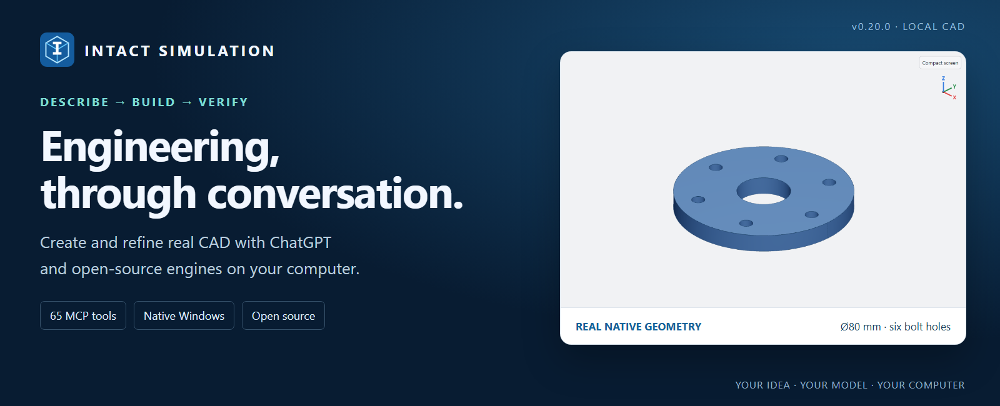
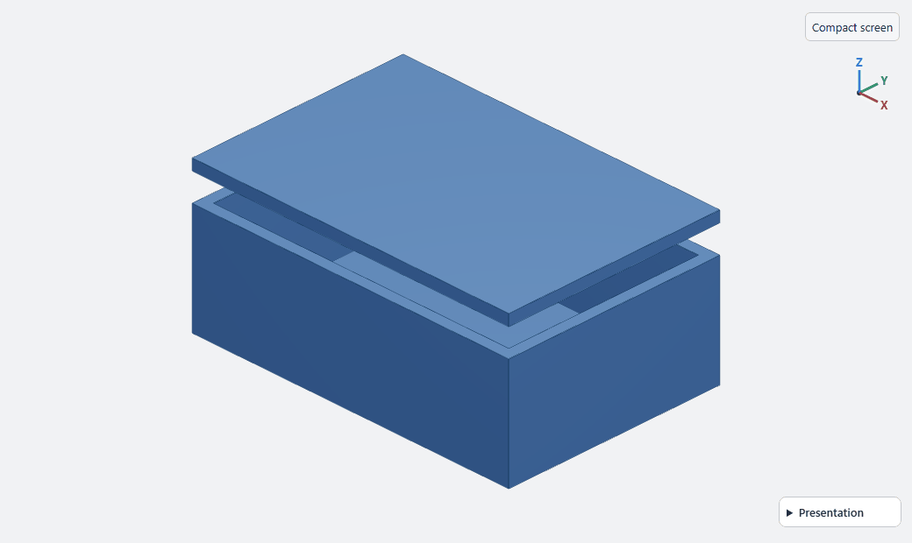
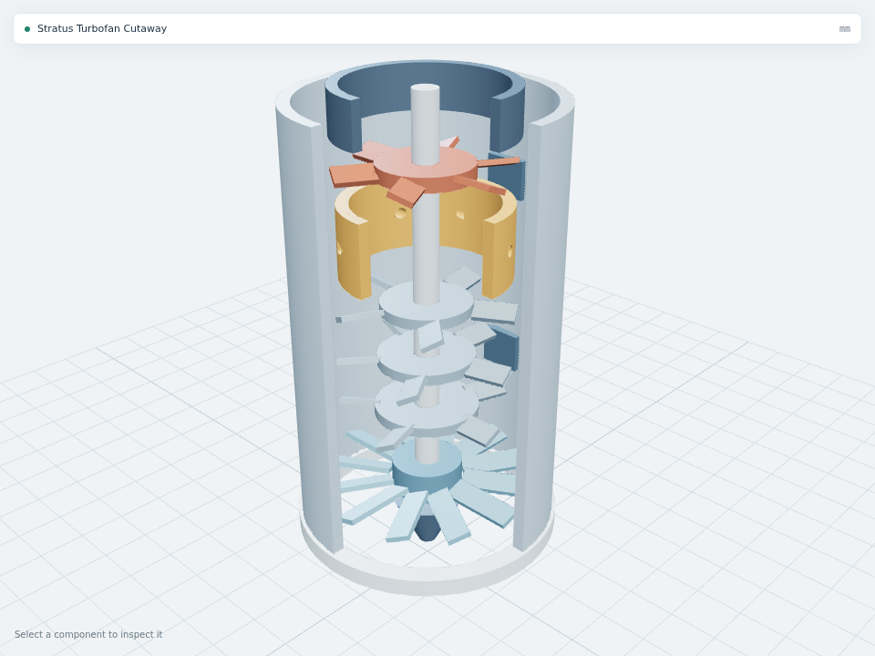
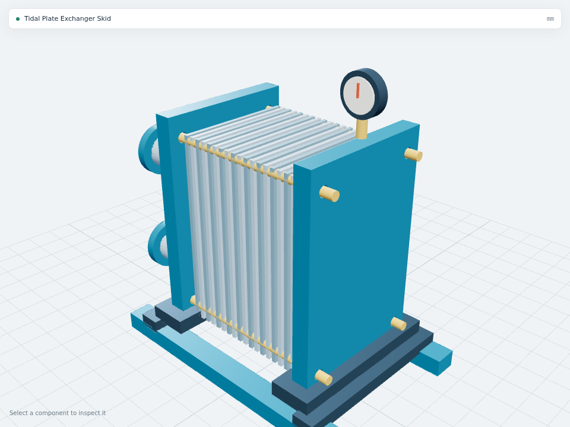
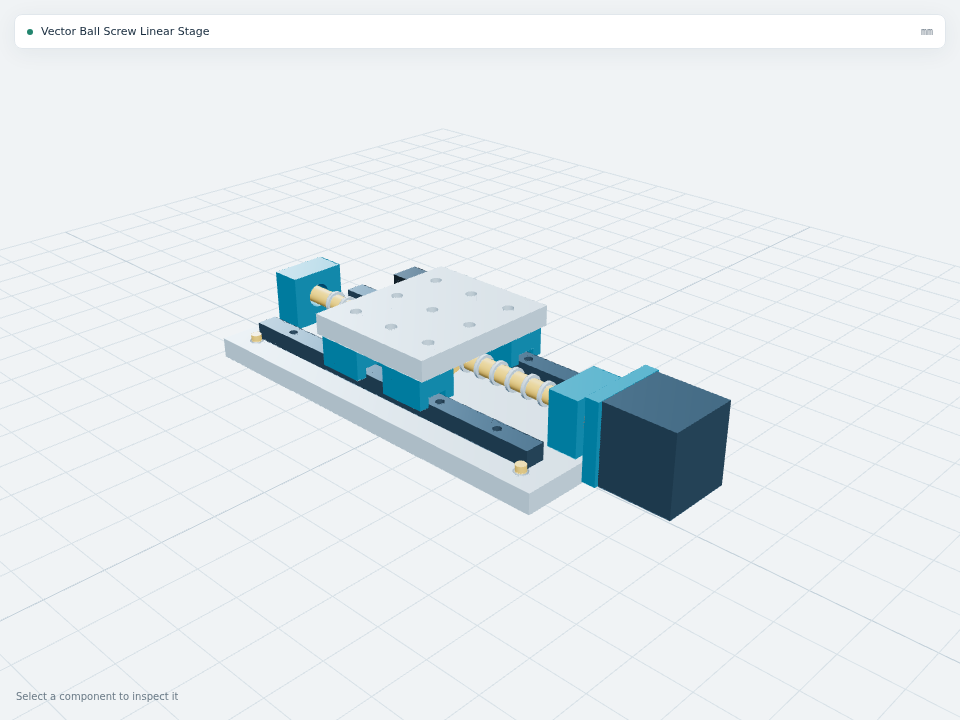
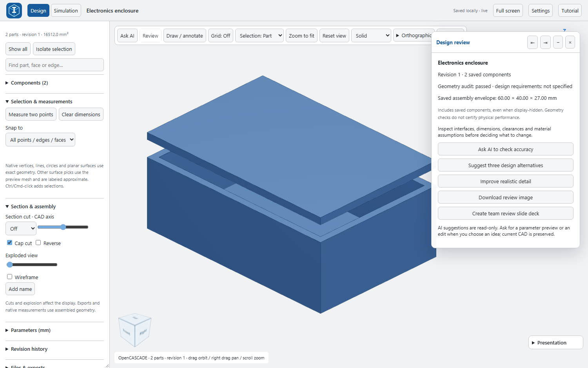
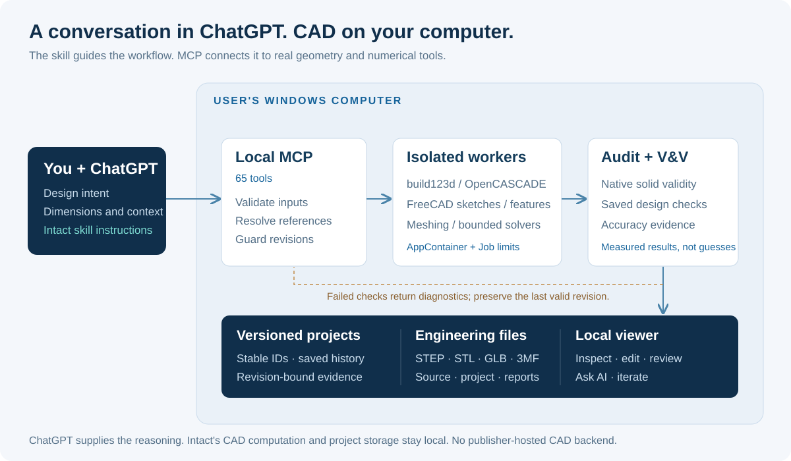

<p align="center">
  
</p>

<h1 align="center">Intact Simulation</h1>
<p align="center"><strong>Turn a design brief into editable CAD, measured geometry and engineering files.</strong></p>
<p align="center">
  <a href="https://www.intactsimulation.com/">Website</a> ·
  <a href="#how-to-use-intact">How to use</a> ·
  <a href="#architecture">Architecture</a> ·
  <a href="models/showcase/README.md">Model gallery</a> ·
  <a href="docs/install.md">Setup</a> ·
  <a href="docs/RELEASE_0_20.md">Release notes</a>
</p>
<p align="center"><strong>v0.20.0</strong> &nbsp; | &nbsp; <a href="docs/TOOLS.md">65 MCP tools</a> &nbsp; | &nbsp; Local CAD execution &nbsp; | &nbsp; Apache-2.0</p>

<p align="center"><strong><a href="https://github.com/mnswba/Intact-Simulation/releases/download/v0.20.0/Intact-Simulation-0.20.0-Windows-Local.zip">Download Windows v0.20.0 ZIP</a></strong> · <a href="docs/INSTALL_WINDOWS_PRIVATE.md">Install on another computer</a> · <a href="https://www.intactsimulation.com/getting-started/">Website setup guide</a></p>

## What is Intact?

Intact Simulation connects ChatGPT to open-source CAD and numerical engines. Describe a part or assembly, supply its dimensions, inspect the result, and refine the design through conversation. Intact creates real geometry with named components, editable parameters and saved revisions, then exports files for other engineering tools.

The purpose is to make early design exploration, geometry inspection and repeatable engineering workflows easier to access. It combines conversational input with tools that can measure and verify what was actually built. It serves engineers, designers, researchers and students who need more than a picture of an idea.

**ChatGPT supplies the reasoning. Your computer builds the CAD.** Intact does not require a publisher-hosted CAD backend. This is a skill **and** executable MCP tools, rather than an instructions-only plugin.

> **Current availability:** the native package targets **Windows x86-64**. Linux source development uses bubblewrap. Native macOS is not supported. The local edition works independently of public-directory publication, which remains pending; this GitHub repository is not an approved ChatGPT directory listing.

**Browser preview:** [Open Intact Browser CAD](https://www.intactsimulation.com/browser-cad/) for a smaller, on-device mesh workshop with primitives, Boolean operations, editable dimensions and STL export. Use ChatGPT through manual JSON recipe exchange. No native CAD installation or publisher CAD server is needed; this is a separate preview, not full 65-tool parity. [Features, architecture and verification](browser-cad/README.md) · [Cross-platform status](docs/CROSS_PLATFORM.md)

## See the workflow

<p align="center"></p>

**Inspect before you change.** This animation records the actual viewer with the bundled two-part enclosure. Explosion changes the display, while the saved CAD geometry stays intact. It is not a recording of AI generation or a simulation result. [Static workspace image](docs/images/readme/workspace.png) · [Example source](models/enclosure.py)

## What you can do

See the [complete 65-tool reference](docs/TOOLS.md) for every registered operation, grouped by workflow, and the distinction between registered tools and installed optional engines.

| Workflow | What Intact provides |
| --- | --- |
| **Create parts and assemblies** | Native solids, parametric Python builds, named parts, placements and STEP imports. |
| **Preserve design intent** | FreeCAD constrained sketches, solver diagnostics and explicit editable feature graphs. |
| **Inspect and refine** | Native faces, edges, vertices, measurements, geometry-aware selections and guarded edits. |
| **Review the design** | Measured design context, read-only AI questions, alternatives and annotated review exports. |
| **Verify geometry** | Solid validity, saved dimension/hole/placement/clearance checks, tolerance settings and evidence reports. |
| **Explore lattices** | Six sampled TPMS families, distance-offset structures, mesh operations and bounded faceted conversion. |
| **Run supported studies** | 3D steady conduction, linear elasticity, creeping-flow Stokes and prescribed kinematic previews. |
| **Deliver usable files** | STEP, STL, GLB, 3MF, source and project JSON; supported drawing, BOM, image and presentation exports. |

### Original design examples

| Aerospace concept | Energy equipment concept | Automation concept |
| :---: | :---: | :---: |
| [](models/showcase/industry-a/stratus-turbofan-cutaway.py) | [](models/showcase/industry-b/tidal-plate-exchanger.py) | [](models/showcase/industry-b/vector-ballscrew-stage.py) |
| Sectioned turbofan | Plate exchanger skid | Ball-screw stage |

These are rendered exports of original Intact concept models, not photographs or certified production designs. Explore [50 examples with source](models/showcase/README.md) or the [interactive Finished Work gallery](https://www.intactsimulation.com/finished-work/).

## How to use Intact

### 1. Set up the local tools

Use a desktop host that supports local MCP execution. [Download the Windows plugin ZIP](https://github.com/mnswba/Intact-Simulation/releases/download/v0.20.0/Intact-Simulation-0.20.0-Windows-Local.zip), then follow the [private installation procedure](docs/INSTALL_WINDOWS_PRIVATE.md), including the exact request to paste into Codex. Use this Windows-Local package rather than GitHub's automatically generated Source code ZIP. The [release page](https://github.com/mnswba/Intact-Simulation/releases/tag/v0.20.0) includes checksums, scope and known limitations. Developer source setup remains in the [installation guide](docs/install.md).

On first use, the Windows launcher automatically downloads the required Python/CAD runtime, FreeCAD and rendering components into your user profile. Allow internet access, several GB of free space and time for setup. Later starts reuse the installed components. **No WSL is required for the native Windows edition.**

Enable Intact in your supported desktop host, then ask it to check `status`. Confirm the version, CAD readiness and completed desktop setup before building. Check **Tutorial** in the viewer to see its installed version. An old conversation or WSL viewer link can retain an earlier connection. [Setup and troubleshooting](docs/install.md)

### 2. Describe the model with dimensions

Start with a specific brief:

> Create a pipe flange with an 80 mm outer diameter, 8 mm thickness and a 24 mm bore. Add six 6 mm holes equally spaced on a 60 mm bolt circle. Name the part flange, verify its dimensions and hole positions, and export STEP and STL.

Give the intended units, important interfaces, clearances and constraints. Ask for clarification when a reference or dimension is ambiguous.

### 3. Inspect and iterate

Open the returned local viewer. Orbit the model, inspect native geometry, measure features and try an exploded view for assemblies. Select the relevant part, face or edge before asking for an edit:

> Increase only the mounting-hole diameter to 7 mm. Preserve the bore, outside diameter, thickness and component placement. Check the result before saving the edit.

Edits use model identity and revision guards. Saved history supports read-only previews and explicit restoration. A failed build or rejected geometry check should preserve the last valid design.

### 4. Review accuracy and engineering assumptions

Open **Review** to see measured geometry context. Ask for read-only accuracy checks or alternatives before changing CAD. In a standalone viewer, **Ask AI** can use a separate model-scoped task through your own signed-in OpenAI local client; it does not automatically join the open ChatGPT conversation. [Ask AI behavior](docs/ASK_AI_HANDOFF.md)

For simulation, first define units, materials, loads/supports or thermal/flow boundary conditions. Read mesh, convergence and verification evidence with the numerical result. Geometry checks do not certify physical performance.

### 5. Export and continue your workflow

Download the appropriate file: **STEP** for supported native solids, **STL/3MF** for mesh workflows, **GLB** for visualization, and **project JSON/source** for continuing the design. Sampled lattices do not become exact smooth STEP surfaces by renaming or converting a file.

<p align="center"></p>

### Useful controls

| Control | Action | Control | Action |
| --- | --- | --- | --- |
| Drag / right-drag / wheel | Orbit / pan / zoom | **F** | Zoom to fit |
| **R** | Design review | **A** | Ask AI |
| **Ctrl/Cmd + K** | Commands and saved views | **Shift + F** | Fullscreen viewer |
| **G** | Toggle grid | **M** | Measure two points |
| **1 / 2 / 3 / 4** | Isometric / front / top / right | **?** | Tutorial and shortcuts |

See the searchable **Tutorial** for the complete controls. Typing in text fields does not trigger geometry shortcuts.

## Architecture

<p align="center"></p>

[Open the full-size architecture diagram](docs/images/readme/architecture.svg).

The **skill** describes the modeling and verification workflow. The **MCP layer** exposes concrete operations and validates their inputs. A project service manages model IDs, revision guards, source and artifacts. Heavy geometry and numerical work runs in isolated workers; the viewer displays the resulting models and evidence.

| Layer | Software and responsibility |
| --- | --- |
| Conversation | ChatGPT interprets the brief, asks questions and calls Intact tools. No separate AI proxy or model training pipeline is required. |
| CAD kernel | Python, **build123d** and **OpenCASCADE** create native solids and engineering exports. |
| Structured modeling | **FreeCAD** solves sketch constraints and rebuilds supported feature graphs. |
| Geometry and meshing | Native topology checks, **Manifold**, **Gmsh**, mesh interchange and bounded implicit sampling. |
| Numerical studies | **NumPy/SciPy** and **scikit-fem** support the implemented, bounded reference and 3D studies. |
| Viewer and delivery | **Three.js** renders the local workspace; **Playwright** supports headless captures and presentation views. |
| Execution boundary | **Windows AppContainer + Job Objects**, or **Linux bubblewrap**, isolate generated CAD and bound its execution. |
| Local setup | A pinned **uv** launcher prepares the Windows Python runtime and dependencies in the user's profile. |

### How audit and V&V help

1. **Validate the request:** check schemas, finite dimensions, references and the expected revision.
2. **Build isolated geometry:** run the CAD program or supported feature graph, and collect native topology and measurements.
3. **Audit the result:** inspect validity and available geometry evidence; compare saved requirements such as dimensions, holes, placement or clearance.
4. **Check engineering evidence:** apply the supported accuracy, mesh/convergence, residual or balance checks relevant to the operation.
5. **Accept or diagnose:** return verified evidence or actionable errors. Review the result against the original brief before export or manufacture.

These checks help expose errors; they do not automatically supply missing requirements or guarantee universal accuracy. [Architecture details](docs/architecture.md) · [Verification record and known issues](docs/QA_0_20.md) · [Simulation scope](docs/simulation.md)

## Platform, scope and privacy

| Platform | Current support |
| --- | --- |
| Windows x86-64 desktop | Native 0.20.0 runtime and local tools. |
| Linux x86-64 | Source/development installation with bubblewrap and required native libraries. |
| macOS / MacBook | Native runtime not implemented or validated. |
| Ordinary web/mobile chat | Cannot execute this local Windows runtime. Website examples are separate browser demonstrations. |

Intact is a single-user local application. It does not claim universal CAD generation, turbulent/inertial CFD, nonlinear/contact mechanics, multiphysics or production certification. Arbitrary STEP imports do not automatically acquire editable parametric history. Review the [release scope](docs/RELEASE_0_20.md) and [known Windows SDK shutdown limitation](docs/QA_0_20.md).

CAD computation and saved project files stay on your computer. Requests and context you send to ChatGPT or the signed-in AI client are processed by that service; local CAD execution does not mean local AI inference. Projects, credentials, browser profiles and downloaded runtimes are excluded from this repository. [Privacy](docs/privacy.md) · [Published privacy policy](https://www.intactsimulation.com/privacy-data/)

## Develop and contribute

The repository contains the plugin instructions, MCP backend, local viewer, public example sources, tests and optional website source. Start with [setup](docs/install.md) and [contribution guidance](CONTRIBUTING.md).

```bash
git clone https://github.com/mnswba/Intact-Simulation.git
cd Intact-Simulation
uv sync --project backend --extra cad --extra dev --frozen
```

<details>
<summary><strong>Source map and development checks</strong></summary>

| Path | Purpose |
| --- | --- |
| `plugin/` | Portable package metadata and Intact skill instructions. |
| `backend/intact_backend/` | CAD, geometry checks, workers, simulations, MCP and viewer delivery. |
| `scripts/viewer/` | Viewer interaction, review, shortcuts and presentation modules. |
| `models/` | Runnable example programs and public design concepts. |
| `backend/tests/`, `tests/` | Backend and viewer/engineering regression checks. |
| `docs/` | Setup, architecture, release scope and verification evidence. |
| `website/` | Product website content and publishing source. |

```bash
uv run --project backend --extra cad --extra dev --frozen python -m pytest backend/tests -q
npm ci
npm test
node scripts/build-plugin-viewer.mjs
python scripts/check-publication.py
```

CAD, FreeCAD, browser and numerical tests need their documented host prerequisites. The test record distinguishes executed checks, skipped tests and known failures. Example exports stay in ignored `outputs/`; runtime binaries and private projects do not belong in Git.

Run a bundled model after setup:

```bash
uv run --project backend --extra cad --frozen python models/run.py flange
```

</details>

## Who is behind Intact?

Intact Simulation was developed by **Abdul Samad**, an R&D engineer at **[URDT](https://urdt.tw/)** and a PhD graduate of National Cheng Kung University, Tainan. URDT is a design company working on equipment and AR/VR experiences.

[Product website](https://www.intactsimulation.com/) · [Contact and support](https://www.intactsimulation.com/contact/) · [Engineering articles](https://www.intactsimulation.com/articles/) · [Terms](https://www.intactsimulation.com/terms-of-service/)

## License

Original Intact source is licensed under [Apache-2.0](LICENSE). Dependencies retain their own licenses, including the CAD kernels and GPL-licensed Gmsh. See [third-party notices](THIRD_PARTY_NOTICES.md). Intact is independent of [Text-to-CAD](https://github.com/earthtojake/text-to-cad); the projects are not interchangeable distributions or endorsements.
