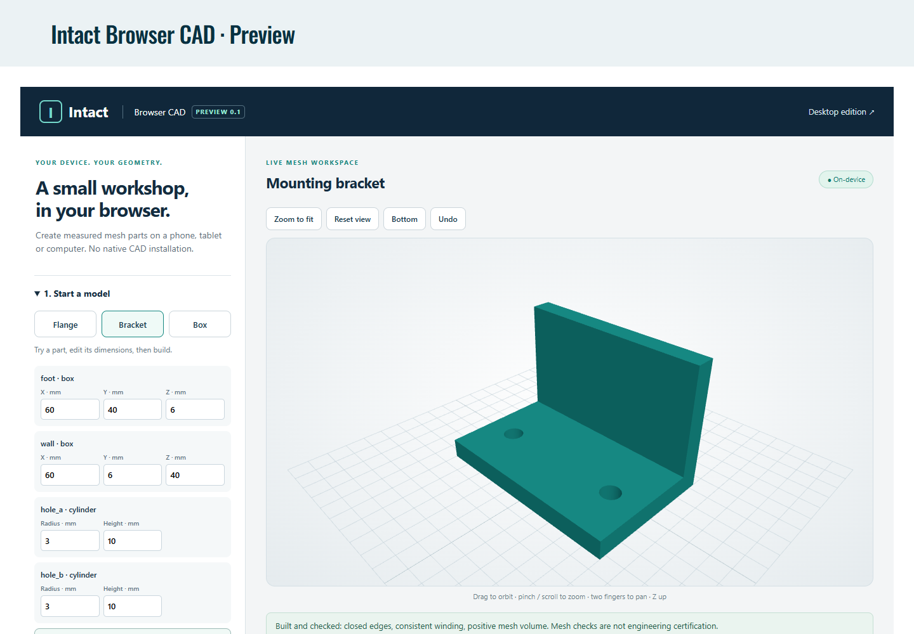

# Intact Browser CAD · preview 0.1.0

**[Open the live browser preview](https://www.intactsimulation.com/browser-cad/)** · [Hosting and user guide](HOSTING.md) · [Full desktop 65-tool catalog](../docs/TOOLS.md)

[Website deployment ZIP (1.62 MB)](https://github.com/mnswba/Intact-Simulation/releases/download/browser-v0.1.0/Intact-Browser-CAD-0.1.0-Website.zip) · [Preview release and checksums](https://github.com/mnswba/Intact-Simulation/releases/tag/browser-v0.1.0). This archive is for website hosting, not ChatGPT plugin submission. Users can simply open the live page instead.

Create small measured mesh parts on the user's device without a native Python/CAD installation or publisher CAD server. This separate edition uses browser capabilities rather than Windows executables; actual device support depends on WebAssembly, WebGL, module workers, available memory and downloads. It is a website preview, not a universal desktop plugin ZIP or an approved ChatGPT directory listing. The working Windows 0.20.0 package is unchanged.



## Use

1. Open the preview; try the flange, bracket or box. Edit the dimension fields and click **Apply dimensions & build**.
2. Open **Design with ChatGPT**, copy the instructions and paste them into your own ChatGPT conversation. Describe your part and dimensions.
3. Paste the returned JSON recipe into the app and click **Build recipe**. ChatGPT does not automatically call or inspect this browser app.
4. Orbit with a drag, zoom with pinch/scroll and pan with two fingers/right drag. **F** fits; **R** resets. Bottom view uses a transparent line grid.
5. Copy the measured report to ChatGPT for discussion. Save recipe JSON for editable geometry and export STL as a polygonal mesh in millimetres. Save before leaving the page.

## Implemented scope

| Included | Boundary |
| --- | --- |
| Boxes, spheres, cylinders and cones | Centered, numeric dimensions in mm |
| Union, subtraction, intersection | Ordered references to previously defined nodes |
| Rotations and translations | XYZ degrees, right-handed Z up |
| Editable dimensions, undo, JSON save/open | Independent from native desktop project JSON |
| Mesh envelope, volume, surface area and closed-edge report | Polygonal measurements; not native B-rep validation or physical certification |
| STL export and touch viewer | No unit field in STL: import as mm |

Not included: native STEP, arbitrary code, mesh imports, fillets, lofts, FreeCAD sketches/features, lattices, numerical studies, native assembly identities or the full 65-tool desktop API. The software refuses unsupported recipe types rather than executing arbitrary AI-generated code or substituting an unrelated template.

## Architecture


The host serves static application bytes. It does not receive model recipes or run CAD compute. No account, API key, analytics or browser autosave is introduced. Information manually pasted into ChatGPT follows ChatGPT's own data handling. Ordinary website asset requests still reach the WordPress host.

The interpreter accepts data only: a maximum 64KiB recipe, 64 nodes, bounded numeric dimensions and circular segments. Unknown fields, executable strings and forward references are rejected. Workers are terminated on cancel or a 30-second deadline; a failed build preserves the previous model. WASM objects are explicitly deleted; replaced GPU geometry/materials are disposed. A browser/OS out-of-memory crash remains possible; workers are not an OS-level hard memory quota.

The WordPress build contains all JS/WASM bytes in an iframe with `allow-scripts allow-downloads allow-popups allow-popups-to-escape-sandbox`, **without** `allow-same-origin`. Its CSP denies network connections and objects. The trusted Manifold Embind runtime requires JavaScript wrapper construction, so this isolated build permits `unsafe-eval`; recipe values never enter an evaluator. The native desktop execution sandbox and code policies are unchanged. No models cross from the iframe to WordPress.

## Build and verification

```sh
cd browser-cad
npm ci
npm test
npm run build
```

`dist/` contains the static deployment, notices and a self-contained WordPress draft page payload. `wordpress-host-preview.html` tests the exact sandbox configuration locally. Output and dependencies are excluded from Git. The release ZIP is a website deployment package, not a ChatGPT plugin submission package.

Verified on 13 November 2026:

- Nine WASM geometry/validation tests passed: known box dimensions/area/volume; Boolean volume and placement; sphere convergence; independent polygonal flange volume; bracket/rotation; hostile/oversized recipe rejection; empty/repeated builds; open-edge detection.
- Existing root `npm test`: all 46 passed after supplying the pinned Three.js dependency.
- Chromium checked both the static app and sandboxed WordPress embedding, then repeated the test against the **live website**: edit/rebuild/undo, invalid/empty result preservation, saved recipe round-trip, binary STL consistency (1,560 flange triangles), Bottom/Reset placement and no page errors.
- Phone (390×844) and tablet (820×1180) Chromium viewport/touch emulation passed without horizontal overflow. These are not real iOS/Android hardware tests. Native Mac, Safari and real mobile devices remain unverified.

See [publication receipt](../website/browser-publication.json). Kernel documentation: [Manifold usage and memory management](https://manifoldcad.org/docs/jsapi/documents/Using_Manifold.html). Manifold is Apache-2.0; Three.js is MIT. Distributed builds include upstream notices and Intact's Apache-2.0 license.
