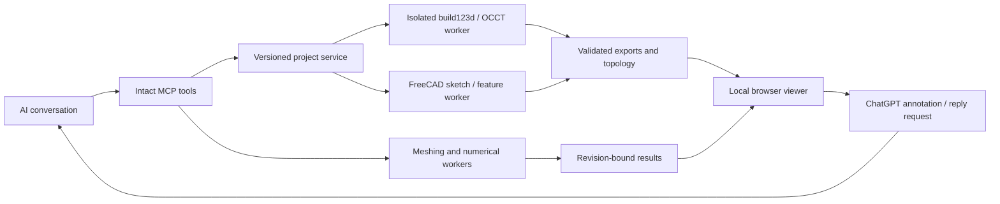

# Architecture

An AI client calls the Intact MCP server. The server validates tool inputs and revision guards, then dispatches CAD/engineering work. The language model is provided by the user's AI client; there is no LiteLLM proxy or model training pipeline in this release.

- `backend/intact_backend/mcp_server.py`: MCP registration and primary tool dispatch.
- `projects.py`: projects, guarded commits, artifacts, immutable revision snapshots and appearance exports.
- `program.py`, `program_policy.py`, `program_worker.py`: generated-Python validation and rootless Linux sandbox execution. AST checks supplement OS isolation.
- `feature_graph.py`, `freecad_worker.py`: explicit structured sketches and feature history. Imported opaque solids do not automatically gain a feature graph.
- `stable_references.py`, `design_checks.py`, `accuracy.py`: named geometry handles, acceptance checks and accuracy evidence.
- `intact_lattice.py`, `advanced_worker.py`: bounded implicit sampling, distance-offset lattices and mesh operations.
- `simulation_worker.py`, `engineering_jobs.py`: supported 3D solves and cancellable jobs with recorded assumptions.
- `viewer_server.py`, `viewer.html`, `scripts/plugin-viewer.mjs`, `scripts/viewer/`: loopback server, browser controls and live geometry/results.
- `edit_requests.py`, `ask_ai.py`: persisted request chains and optional scoped local AI fallback. Native browser handoff is in `scripts/viewer/chat-handoff.mjs`.
- `plugin/skills/intact-cad/`: AI workflow instructions and tool contracts; not neural-network weights.
- `app/`, `components/`, `lib/`: separately hosted website development source.

The local viewer has a private tokenized URL. It must not be exposed as a public multi-user service. History previews are read-only; restoring is a separate guarded operation. Replies retain conversation text; stale native selections are not silently reused. Artifacts, solver results and sampled approximations carry distinct provenance and limitations.
